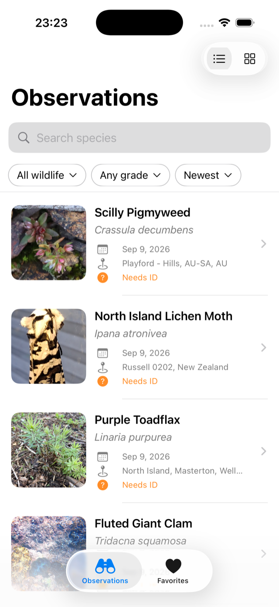
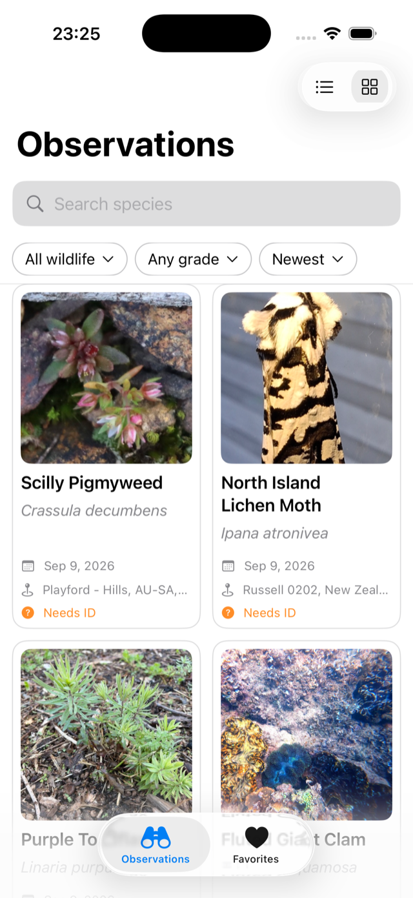
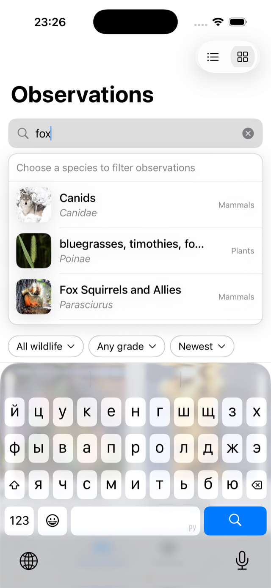
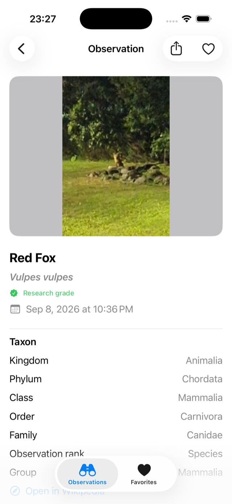
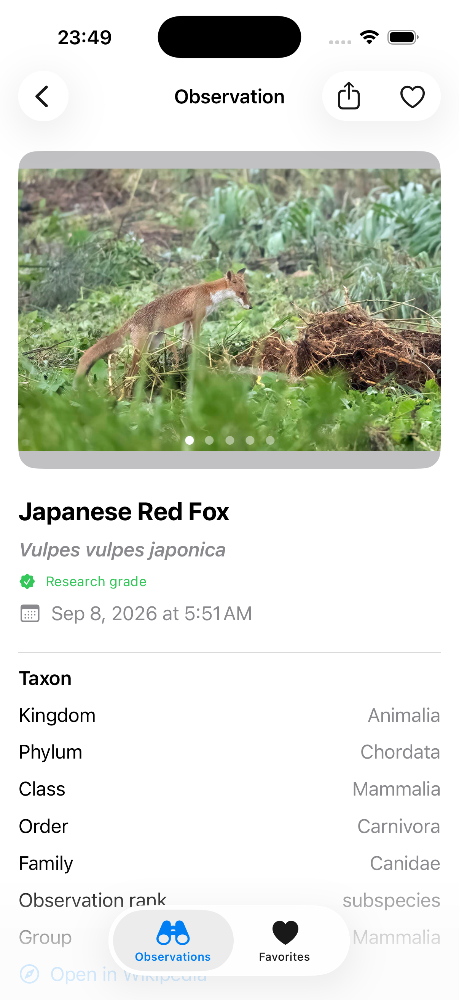
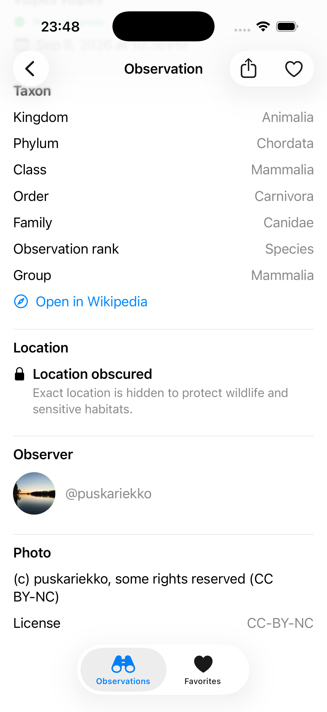
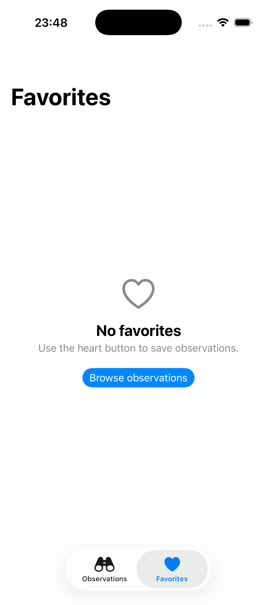
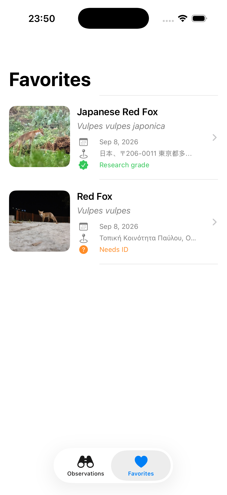

# Wildlife Atlas

Wildlife Atlas — iOS-приложение для просмотра публичных наблюдений за живой природой из [iNaturalist API v2](https://api.inaturalist.org/v2/). Приложение позволяет искать таксоны, фильтровать ленту, просматривать подробную информацию о наблюдении и сохранять выбранные наблюдения локально.

Проект выполнен в рамках [тестового задания для стажёра iOS](./ios-trainee-assignment-autumn-2026.md).

## Скриншоты

| Лента | Режим «Плитка» |
| --- | --- |
|  |  |

| Поиск таксона | Детали наблюдения |
| --- | --- |
|  |  |

| Галерея фотографий | Локация, автор и лицензия |
| --- | --- |
|  |  |

| Пустое избранное | Сохранённые наблюдения |
| --- | --- |
|  |  |

## Решения, принятые в ходе разработки

- Использовать только iNaturalist API v2 из ссылки задания, а не похожий API v1.
- Оставить интерфейс и данные на исходном английском языке; для API явно передавать `locale=en`.
- Разместить Observations и Favorites в отдельных вкладках, потому что избранное — самостоятельный раздел, а не действие над лентой.
- Поместить Share и Favorite рядом в toolbar деталей: оба действия относятся к открытому наблюдению и не конкурируют с навигацией назад.
- Переключать список и плитку через компактный segmented Picker, поскольку это два взаимоисключающих режима.
- Сохранять выбранный layout между запусками, но не сохранять загруженные страницы ленты: режим является настройкой пользователя, а сетевые результаты — временным состоянием.
- Показывать три фильтра одной горизонтально прокручиваемой строкой. Для таксона дать быстрый выбор базовых групп, а полный каталог искать через autocomplete.
- Не использовать системную кнопку Cancel в поиске. Крестик очищает запрос и закрывает клавиатуру, нажатие на затемнённый фон закрывает поиск целиком.
- Затемнять не только ленту, но и tab bar, чтобы открытые подсказки воспринимались как единый modal-like слой.
- Сохранять последние пять таксонов и показывать их до начала ввода — это дополнительный пункт задания и полезный быстрый повтор фильтра.
- Сделать один одинаковый footer пагинации с spinner и спокойной подписью, не заменяя им уже загруженный контент.
- Использовать skeleton с заметным shimmer и для ленты, и для деталей, чтобы загрузка не выглядела как пустой или мигающий экран.
- Загружать детали отдельным запросом, потому что карточка ленты содержит только краткую модель. Из Favorites, наоборот, открывать сохранённую полную модель без сети.
- Показывать все фотографии встроенной галереей, использовать более качественные URL и менять атрибуцию вместе с выбранной фотографией.
- Всегда сохранять место под изображение и показывать заглушку, если фотографии нет; это не даёт карточкам списка и сетки «поехать».
- Не скрывать сам факт приватности: для obscured/private показывать `Location obscured` и объяснение, но никогда не запрашивать и не отображать точные координаты.
- Делиться публичным `uri` наблюдения, полученным от сервера, а не генерировать собственную ссылку и не отправлять локальную модель.
- Хранить Favorites в SwiftData вместе с полными деталями, чтобы избранное переживало перезапуск и открывалось без повторной загрузки.
- Использовать один UUID наблюдения во всех слоях вместо параллельных `id` и `uuid`.
- Разнести код по `App`, `Core`, `Data` и `Features`, а внутри Observations отдельно хранить Components, Details и TaxonSearch, чтобы файлы одной большой feature не лежали плоским списком.
- Не добавлять лишние coordinator, use-case и data-source слои: структура должна отражать реальные ответственности текущего задания.
- Не размечать всё приложение `MainActor`: UI-состояние и SwiftData изолированы на главном actor, а stateless-сетевой клиент остаётся обычной `Sendable`-структурой.
- Сделать actor только для `ImagePipeline`, где действительно есть разделяемое изменяемое состояние и объединение параллельных загрузок.

## Возможности

### Лента наблюдений

- первая страница последних публичных наблюдений загружается при открытии приложения;
- во всех запросах наблюдений передаётся обязательный параметр `captive=false`;
- поддерживается постраничная загрузка по 20 элементов;
- следующая страница запрашивается только при появлении последней загруженной карточки;
- элементы можно отображать списком или адаптивной сеткой;
- выбранный режим отображения сохраняется между запусками;
- карточка показывает фотографию, общепринятое и научное названия, дату, качество и доступное приблизительное место;
- отсутствующие изображения заменяются нейтральной заглушкой.

### Поиск и фильтрация

- динамический поиск по каталогу таксонов iNaturalist;
- задержка перед запросом и отмена устаревших поисковых задач;
- сохранение пяти последних выбранных таксонов;
- независимые фильтры по таксону, качеству и порядку даты;
- изменение любого фильтра перезагружает первую страницу с учётом остальных значений;
- поиск и результаты визуально отделяются от ленты затемнением фона, нажатие вне области поиска закрывает его.

### Детали наблюдения

- галерея всех доступных фотографий;
- общепринятое и научное названия;
- качество, дата и время наблюдения;
- таксономическая классификация от царства до семейства, если она доступна;
- ранг наблюдаемого таксона, группа и ссылка на Wikipedia;
- приблизительное место либо явное состояние `Location obscured`;
- имя, логин и аватар наблюдателя;
- атрибуция и лицензия выбранной фотографии;
- возможность поделиться публичной ссылкой на наблюдение;
- возможность добавить наблюдение в избранное.

### Дополнительные возможности

- локальный раздел избранного;
- открытие сохранённых деталей без повторного сетевого запроса;
- удаление из избранного свайпом;
- кэширование изображений в памяти;
- мерцающие skeleton-состояния первоначальной загрузки;
- отдельные состояния загрузки, контента, пустого результата и ошибки с повтором запроса.

## Технологии

- Swift 5;
- SwiftUI;
- Swift Concurrency (`async/await`, `Task`, `actor`);
- Observation (`@Observable`);
- URLSession;
- SwiftData;
- UserDefaults;
- NSCache;
- iOS 17.0+;
- без сторонних библиотек.

## Сборка и запуск

Проект собирался и проверялся в Xcode 26.3. Минимальная версия iOS — 17.0.

1. Клонируйте репозиторий.
2. Откройте `WildlifeAtlasApp/WildlifeAtlasApp.xcodeproj` в Xcode.
3. Выберите схему `WildlifeAtlasApp`.
4. Выберите симулятор или устройство с iOS 17.0 и новее.
5. Запустите приложение сочетанием `⌘R`.

Дополнительная установка зависимостей и API-ключ не требуются. Для загрузки данных и изображений приложению нужен доступ к интернету.

Интерфейс использует английские подписи, а в запросах передаётся `locale=en`. Это сохраняет названия и терминологию консистентными с исходным макетом.

## Архитектура

Используется MVVM с однонаправленным обновлением состояния:

`View → пользовательское событие → ViewModel → Repository → APIClient`

`View ← состояние экрана ← Domain model ← DTO ← API`

Локальные данные проходят отдельным путём:

- Favorite action → FavoritesStore → FavoritesRepository → SwiftData
- Layout / recent taxa → AppSettings → UserDefaults
- Image request → ImagePipeline → NSCache / URLSession

Зависимости создаются в `AppDependencies` и явно передаются через инициализаторы. Это сохраняет зависимости видимыми, упрощает замену реализаций и не связывает экраны с глобальными singleton-объектами или неявными значениями `Environment`.

### Разделение моделей

Для ленты и деталей используются разные модели: `ObservationSummary` содержит только данные карточки, а `ObservationDetails` — полный набор данных экрана деталей. Это осознанное разделение, а не дублирование: страница из 20 наблюдений не должна загружать авторов, лицензии, все фотографии и классификацию для каждого элемента.

DTO повторяют структуру JSON и остаются внутри `Data`. Domain-модели описывают потребности приложения: например, `ObservationLocation` выражает доступное приблизительное место и скрытое место как разные состояния, а не заставляет UI интерпретировать комбинацию `geoprivacy`, `taxon_geoprivacy` и `obscured`.

В domain-модели наблюдения оставлен один идентификатор — UUID iNaturalist. Его достаточно для `Identifiable`, навигации, запроса деталей и SwiftData; второй числовой идентификатор создавал бы два источника идентичности без пользы для приложения.

Коллекция фотографий не optional: отсутствие фотографий естественно представляется пустым массивом. При этом свойства отдельной фотографии, таксона и автора остаются optional, потому что сервер действительно может их не прислать.

### Почему выбран MVVM

У приложения несколько экранов со своей асинхронной логикой и взаимоисключающими состояниями. View отвечает только за отображение и пользовательские действия, а ViewModel управляет загрузкой и переходами состояния. Для текущего объёма задания этого достаточно: дополнительные coordinator, use-case и data-source слои усложнили бы код без новой ответственности.

### Почему API скрыт за Repository

Интерфейсы `ObservationRepository` и `TaxonRepository` отделяют сценарии приложения от формата iNaturalist. Сетевые DTO находятся в `Data`, преобразуются в модели приложения и не попадают во ViewModel. Благодаря этому UI не знает названия JSON-полей и правила API.

`APIClient` отвечает только за создание GET-запроса, проверку HTTP-ответа и декодирование. Он реализован структурой, а не `actor`, поскольку собственного изменяемого состояния у клиента нет.

### Почему используется явная модель состояния

Для ленты, поиска и деталей используются enum-состояния `idle`, `loading`, `content`, `empty` и `failure`. Они не позволяют одновременно показать несовместимые состояния, например контент и ошибку первоначальной загрузки.

Ошибка пагинации хранится отдельно от основного состояния ленты. Уже загруженные наблюдения поэтому остаются на экране, а повторить нужно только запрос следующей страницы.

Состояния объявлены внутри соответствующих ViewModel, поскольку являются деталями конкретного экрана и нигде больше не переиспользуются. `ContentState` ленты объединяет элементы, номер следующей страницы и состояние пагинации — View получает один согласованный снимок данных вместо набора независимых флагов.

Настройки вроде размера страницы, задержки поиска и лимита результатов объявлены как `private static let` внутри владельца логики. Это неизменяемые параметры реализации, одинаковые для всех экземпляров, но они не относятся к предметной модели и не должны находиться в глобальном namespace.

### Пагинация

Наличие следующей страницы определяется по `total_results`, `page` и `per_page`, которые возвращает сервер:

`page × per_page < total_results`

Если условие выполняется, следующей считается `page + 1`. Перед добавлением новой страницы элементы фильтруются по UUID, чтобы наблюдение не продублировалось при изменении данных на сервере между запросами.

Версия запроса защищает ленту от гонки: ответ, начатый со старыми фильтрами, не может заменить результат более нового запроса.

### Поиск таксонов

Поиск начинается с двух символов и использует debounce 300 мс. Предыдущая `Task` отменяется при изменении строки, поэтому быстрый ввод не создаёт цепочку устаревших обновлений UI.

Последние пять выбранных таксонов — небольшая пользовательская настройка, поэтому они сохраняются в `UserDefaults`, а не в отдельной базе данных. Повторно выбранный таксон перемещается в начало и не дублируется.

### UX поиска и фильтров

Поле поиска сделано собственным компактным компонентом вместо системного `.searchable`: системная реализация добавляла кнопку Cancel и меняла геометрию навигации, что расходилось с макетом. Кнопка-крестик очищает запрос и одновременно убирает клавиатуру.

`FocusState` нужен не для хранения бизнес-состояния, а только для управления фокусом `TextField`: закрытия клавиатуры по крестику, выбору таксона, нажатию на затемнённую область и переходу на другую вкладку. Поисковый запрос при уходе в Favorites очищается, поэтому overlay не остаётся поверх другого экрана.

Подсказки ограничены по высоте и прокручиваются внутри своего контейнера. Лента и tab bar на время поиска затемняются как единый фон; нажатие по затемнённой области закрывает поиск. Фильтры остаются под облаком подсказок, как в исходном макете.

Таксон без активного выбора раскрывает короткий список базовых групп — Animals, Plants и Fungi. Полный каталог не помещается в popover и доступен через поиск. После выбора таксон превращается в выделенный chip с крестиком: действие становится однозначным — удалить текущий фильтр.

Качество содержит ровно предусмотренные заданием значения `Any grade` и `Research grade`, а порядок — `Newest` и `Oldest`. Это три независимых значения в `ObservationFilters`; изменение одного создаёт новый набор фильтров, сохраняя остальные.

Панель chips горизонтально прокручивается по всей площади, в том числе когда жест начинается на элементе. Заголовок chip использует фактическую ширину текста, поэтому длинное выбранное значение не обрезается до старого размера. Стрелка открытого popover анимированно поворачивается вверх и возвращается вниз после закрытия.

### Режимы списка и плитки

Список и плитка взаимоисключающие, поэтому для переключения выбран `Picker` со стилем segmented, а не два независимых Button или Toggle. В интерфейсе показаны только системные иконки, чтобы контрол оставался компактным; текстовые названия `List` и `Grid` всё равно заданы у элементов и не дублируются визуально.

ViewModel предоставляет `layoutMode` только для чтения извне. Поэтому Picker получает контролируемый `Binding`: setter вызывает `selectLayoutMode`, а тот одновременно обновляет состояние и сохраняет выбор в `UserDefaults`. Прямая запись через `$viewModel.layoutMode` обошла бы эту логику сохранения.

Сетка использует adaptive-колонки с минимальной шириной 160 pt. `@ScaledMetric` позволяет этой минимальной ширине расти вместе с Dynamic Type: при крупном тексте сетка уменьшает число колонок вместо наложения подписей друг на друга. В строке списка фотография имеет фиксированные 108 × 108 pt, потому что там размер изображения является частью стабильной горизонтальной геометрии, а не правилом выбора числа колонок.

Карточки плитки растягиваются до одинаковой высоты строки. `Spacer` удерживает дату, место и качество у нижней границы, поэтому разная длина названий не сдвигает метаданные и сетка остаётся ровной. Изображение всегда квадратное и обрезается внутри собственных границ.

### Загрузка деталей

Лента получает только поля, нужные карточке. При переходе из ленты выполняется запрос полной модели наблюдения: это уменьшает размер страниц и не загружает заранее данные, которые пользователь может не открыть.

iNaturalist не возвращает цепочку предков таксона в ответе наблюдения, поэтому классификация запрашивается отдельно по `taxon.id`. Этот запрос является необязательным: если он завершится ошибкой, экран всё равно откроется с остальными данными.

Избранное хранит полную модель деталей. Поэтому сохранённое наблюдение открывается локально, без повторного запроса и без мигания skeleton-состояния.

Первоначальная загрузка ленты и загрузка деталей показываются skeleton-компоновкой той же формы, что и будущий контент. Это сохраняет геометрию экрана и визуально объясняет ожидание лучше, чем пустой экран или один spinner. Для пагинации используется один компактный footer `Loading more observations…`: основной контент при этом не исчезает.

Фотографии ленты запрашиваются в размере `medium`, а экран деталей использует `large`. Так превью не выглядят размытыми, но лента не загружает полноразмерные оригиналы. Галерея показывает изображение через `fit`, чтобы фотография не обрезалась; серый фон заполняет свободное место при другом соотношении сторон.

Лицензия и атрибуция относятся к конкретной фотографии, поэтому блок Photo обновляется вместе с выбранной страницей галереи. Share показывается только при наличии публичного `uri` от API и передаёт именно ссылку на наблюдение, а не локальный текст или скачанный файл.

### Работа с датами

Дата наблюдения представлена отдельным значением `ObservationDate`, а не моментом времени `Date`. Строка формата `YYYY-MM-DD` в API означает календарную дату наблюдения; преждевременное преобразование в абсолютный момент времени могло бы сдвинуть день при смене часового пояса.

Год, месяц и день валидируются григорианским календарём. Время хранится отдельно в `ObservationTime` и объединяется с датой только перед форматированием для интерфейса.

### Приватность местоположения

Точные координаты не запрашиваются, не декодируются и не сохраняются. Модель местоположения содержит только два допустимых состояния:

- `approximate` — текстовое приблизительное описание из `place_guess`;
- `obscured` — сервер сообщил, что место скрыто или приватно.

Во втором случае приложение объясняет пользователю отсутствие места, но не показывает защищённые данные. Если сервер вообще не прислал информацию о местности, секция не отображается.

Для obscured/private-наблюдения надпись о скрытой локации показывается намеренно: это известное состояние данных, а не отсутствие ответа. Точное значение места при этом не попадает в UI. Если `place_guess` отсутствует и сервер не сообщил о приватности, приложение ничего не придумывает и полностью скрывает секцию.

### Избранное и границы MainActor

Избранные наблюдения сохраняются через SwiftData, потому что это структурированные модели, которые должны переживать перезапуск приложения. UUID наблюдения используется как устойчивый идентификатор и предотвращает сохранение неверной карточки.

При повторном сохранении запись с тем же UUID обновляется, а не дублируется. В SwiftData сохраняется полный snapshot деталей, включая массив фотографий, классификацию, публичную ссылку и состояние локации. Поэтому Favorites остаётся полезным после перезапуска и не зависит от доступности API при каждом открытии карточки.

`FavoritesRepository` и `FavoritesStore` изолированы `MainActor`, поскольку `ModelContext` SwiftData привязан к своей очереди и изменения сразу отражаются в UI. Сетевые репозитории и `AppDependencies` целиком не помечены `MainActor`; изоляция применяется только там, где она действительно нужна. Производственный инициализатор `AppDependencies` вызывается на `MainActor`, потому что внутри создаётся SwiftData-репозиторий.

### Кэширование изображений

`ImagePipeline` реализован как `actor`, потому что хранит изменяемый словарь выполняющихся задач. Для одного URL переиспользуется уже начатая задача, поэтому несколько карточек не загружают одно изображение параллельно.

Готовые изображения помещаются в `NSCache` с лимитом стоимости 64 МБ. Это именно кэш в памяти: система может освободить его при нехватке ресурсов, а после нового запуска изображения загружаются заново.

Дисковый кэш изображений намеренно не добавлялся: задание просит кэширование в памяти, а отдельное управление сроком жизни файлов, очисткой и миграциями не оправдано текущим объёмом. При ошибке или отсутствии URL компонент показывает одинаковую заглушку, сохраняя размер карточки.

### Сохранение состояния ленты

`ObservationsViewModel` создаётся на уровне корневого `TabView`, а экран деталей открывается внутри того же `NavigationStack`. При возврате не создаётся новая модель ленты, поэтому сохраняются загруженные страницы, фильтры, режим отображения и позиция прокрутки.

У вкладки избранного отдельный `NavigationStack`. Это не смешивает историю навигации двух независимых разделов.

Переключатель list/grid и ViewModel ленты находятся выше дочерних экранов, поэтому переход в детали не сбрасывает фильтры и загруженные страницы. При полном завершении процесса состояние сетевой ленты начинается заново с первой страницы — оно не является пользовательскими данными и специально не сохраняется на диск.

## Структура проекта

<pre>
WildlifeAtlasApp/
├── App/                    # composition root и корневая навигация
├── Core/
│   ├── Images/             # загрузка и кэш изображений
│   ├── Models/             # модели предметной области
│   ├── Networking/         # общий API-клиент
│   ├── Repositories/       # интерфейсы источников данных
│   └── Settings/           # небольшие локальные настройки
├── Data/
│   ├── Favorites/          # реализация хранения в SwiftData
│   ├── Observations/       # iNaturalist DTO и репозиторий наблюдений
│   └── Taxa/               # iNaturalist DTO и репозиторий таксонов
└── Features/
    ├── Favorites/          # экран и состояние избранного
    └── Observations/       # лента, фильтры, поиск и детали
</pre>

`Core` содержит общие модели, интерфейсы и сервисы, не привязанные к одной feature. `Data` реализует объявленные в `Core` интерфейсы для iNaturalist и SwiftData. `Features` работает с моделями приложения и репозиториями, не декодируя сетевые ответы самостоятельно.

## Обработка отсутствующих данных

Поля iNaturalist рассматриваются как необязательные. Если имя, фотография, дата, место, автор, атрибуция или лицензия отсутствуют, соответствующий элемент не создаётся либо не отображается. Для отсутствующей фотографии используется заглушка, поскольку без неё геометрия карточек списка и сетки была бы нестабильной.

Такой подход позволяет показать доступную часть наблюдения и не подменяет отсутствующие данные придуманными значениями.

## PS

В идеале надо добавить unit и snapshot тесты, но я не успел..
